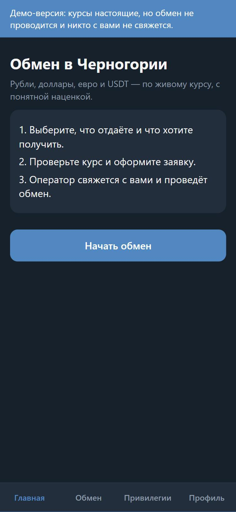
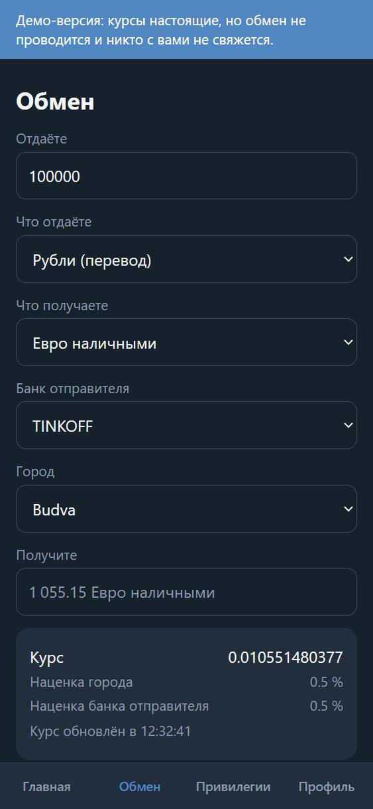
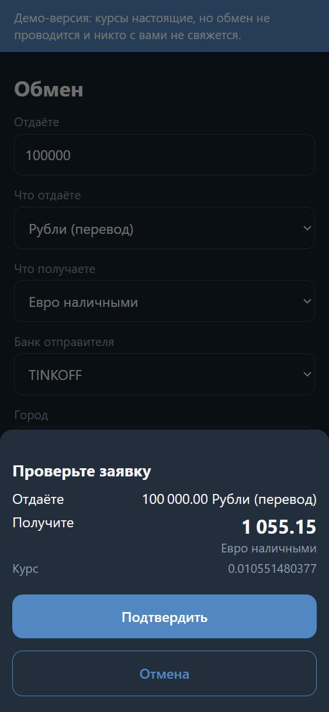
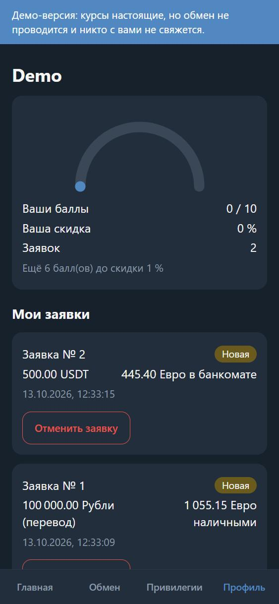
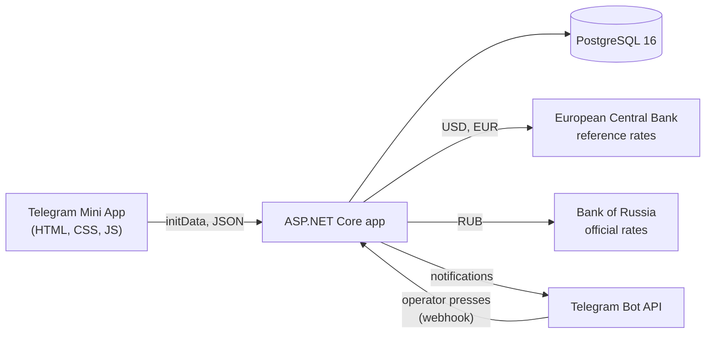

# Exchange Mini App

A Telegram Mini App for a currency-exchange office in Montenegro. A client picks what they give
(roubles by bank transfer, dollars or euros in cash, USDT) and what they receive (euros in cash,
at an ATM, by transfer or invoice, or USDT), sees a live quote with every markup itemised, and
places an exchange request. The office's operator handles each request from a Telegram chat,
and the client follows its status in the app. The app never moves money.

Built with ASP.NET Core 10, EF Core and PostgreSQL behind a plain HTML/CSS/JavaScript front end,
under a written specification ([docs/SPEC.md](docs/SPEC.md)) with every non-obvious choice
recorded ([DECISIONS.md](DECISIONS.md)).

| Home | Live quote | Confirmation | Profile and history |
|---|---|---|---|
|  |  |  |  |

The interface is in Russian, the office's clients' language; every text lives in one locale
file ([src/Exchange.Api/wwwroot/locale/ru.json](src/Exchange.Api/wwwroot/locale/ru.json)),
which the server reads too.

## Try it

Needs Docker only.

```bash
docker compose up
```

Then open <http://localhost:8000> in a browser. This is the **demo mode**
([spec 1.9](docs/SPEC.md)): no Telegram account, bot or secret is needed, rates are live, and
while it runs nothing leaves the machine except the two rate requests and the browser loading
Telegram's WebApp script. Each `docker compose up` starts with an empty database; the app is
published on `127.0.0.1` only.

## What it does

- **Quotes** for every supported direction from live official rates, with the city, bank and
  USDT-network markups shown line by line. The form asks only for the fields the chosen
  direction needs, read from the same table the server enforces.
- **Orders** priced by the server, never by the client; each stores the full rate snapshot it
  was priced from, so any order can be recomputed and audited later.
- **An operator bot**: each new order reaches the operator's Telegram chat with buttons for the
  allowed next statuses (`PENDING -> CONFIRMED -> PROCESSING -> COMPLETED`, or `CANCELLED`); the
  client is messaged on every change and can cancel a request that is still pending.
- **Sign-in through Telegram**: the Mini App's signed `initData` is verified on the server and
  exchanged for a short-lived token kept in memory only.

## How it is built



| Part | Choice |
|---|---|
| Web | ASP.NET Core 10 minimal APIs, Kestrel |
| Data | PostgreSQL 16, EF Core 10 with Npgsql, migrations applied by a command (at startup in demo mode) |
| Domain | A separate project with no framework references: the rate engine, rounding, the status machine, the field rules |
| Front end | Plain HTML, CSS and JavaScript, served by the app; Telegram's WebApp script is the only external file |
| Security | JWT bearer tokens (HS256), AES-256-GCM for personal data at rest |
| Logging | Serilog with source-generated log methods, JSON lines or a console format (`LOG_FORMAT`) |
| Tests | xUnit v3, Shouldly, Testcontainers (a real PostgreSQL), `WebApplicationFactory` |
| Packaging | Docker, Docker Compose |

## Engineering highlights

**Secrets and personal data.** Every secret comes from the environment; the app refuses to start
while one is missing, malformed or still a placeholder, and names the variable, never the value.
A client's IBAN, recipient name, wallet address and payment purpose are encrypted at rest with
AES-256-GCM, each bound to its column. Every log event passes one redacting sink before any
output: values under secret-sounding names are masked at any depth, and bot-token, JWT and
password patterns are masked anywhere in a message. Tests scan every tracked file, and every
commit in the history, for a bot token, a JWT, a private key or a `.env` file.

**Money.** Amounts and rates are `decimal` from the database to the JSON response, where they
travel as strings; a test checks that no binary floating point enters the money code. Rounding
happens in one function. The server recomputes every price itself from the amount given: a rate,
receive amount or user id sent by the client is ignored.

**Rates that are honest about their age.** Each source has its own cache and freshness window.
The European Central Bank and the Bank of Russia publish once a business day, so a rate is
checked against its publication date, and a cached rate stops being served the moment its window
closes. When no fresh rate exists, the API answers 503 and the app says so: it never shows a
stale or invented number.

**Telegram authentication done by the book.** The `initData` signature is checked with HMAC as
Telegram specifies, its age is limited to 24 hours, and identity comes only from that signature
or the server's own token. Every refusal is the same 401; only the log says why.

**The operator workflow.** Status changes go through one transition function under a row lock
(`SELECT ... FOR UPDATE`), with a history row for each; button presses count only from the
configured operator accounts, and the webhook checks Telegram's secret header in constant time.
Notifications are queued, retried with backoff off the request path, and never fail the order.

**Logging as a feature.** Every failure is logged at `ERROR` with its context and stack, and
every `ERROR` is forwarded to the operator's chat, at most once per kind per cooldown. A clean
container start logs no warning.

**Demo mode without weakening production.** The demo's sign-in route exists only in demo mode,
and demo mode refuses to start next to any production secret or a database password, so a real
installation cannot be switched into it by a stray variable. In demo mode nothing is sent to
Telegram, and no message text is logged.

**Tests.** About 1 400 tests, the integration ones against a real PostgreSQL started by
Testcontainers, never a mocked database. The specification's tables become parameterised tests
row by row, including the HTTP contract of every route and error body; every validator has a test
proving it rejects bad input; and the guards were checked by breaking the line each one guards
and watching its test fail. The front end, which the suite does not drive in a browser, is held
to its rules by static scans: nothing loaded from outside Telegram, no token in browser storage,
no text missing from the locale file. Build warnings are errors, with the recommended analyzers
on.

**Process.** From the first line of code on, each change went through its own pull request into
`dev`, with continuous integration and an independent review of the staged diff before every
commit. Each completed phase ended at a gate checked in the real environment; the Mini App's was checked on a phone inside
Telegram.

## Running it for real

With a Telegram bot of your own, a PostgreSQL database, and the .NET SDK pinned in
[global.json](global.json):

Copy `.env.example` to `src/Exchange.Api/.env` and fill in every `<placeholder>`: the bot token,
a webhook secret, a JWT key, a PII key, the database URL, and the operator's chat and account
ids. The file is read in development only (`APP_ENV` unset or `development`). Then, in `src/Exchange.Api`:

```bash
dotnet run -- migrate
```

```bash
dotnet run
```

The app serves `http://127.0.0.1:8000` (`SERVE_HOST` changes the address). Telegram opens Mini
Apps over HTTPS only, so the bot's menu button needs a public HTTPS address in front of it. In
production, Telegram delivers the operator's button presses to `POST /api/bot/webhook`; register
that address yourself with `setWebhook` and the webhook secret. Without a public address, start
the app with `dotnet run -- poll` instead: it removes any registered webhook, then polls Telegram
for the presses (it refuses to run in production and demo mode).

Tests, with Docker running (the integration tests start a real PostgreSQL):

```bash
dotnet test
```

## Rate sources

- `USD` and `EUR`: euro foreign exchange reference rates. Source: European Central Bank
  (<https://www.ecb.europa.eu>). The ECB publishes them for information purposes.
- `RUB`: official exchange rates. Source: Bank of Russia (<https://www.cbr.ru>).

Both are official daily rates rather than market quotes; the office's markups sit on top of
them.

## Limitations

| ID | Limitation |
|---|---|
| `L-1` | `USD` and `EUR` are priced from the ECB's daily reference rates, not market rates |
| `L-2` | No payments: deals are completed by the operator outside the app |
| `L-3` | The loyalty discount and the admin panel are specified (`PHASE-6`) but not built; the Profile tab shows points as stored and no discount |
| `L-4` | Purging personal data after 90 days and rotating the PII key are not automated |
| `L-5` | `RUB` is priced from the Bank of Russia's official daily rate, not a market mid |
| `L-6` | The front end is checked by static scans and by hand, not by browser automation |
| `L-7` | Nothing is deployed; the demo runs locally |

Severities and workarounds: section 8 of [the specification](docs/SPEC.md). Domain assumptions
still waiting for the office's confirmation are listed in [NEEDS_REVIEW.md](NEEDS_REVIEW.md).

## License

MIT - see [LICENSE](LICENSE).
